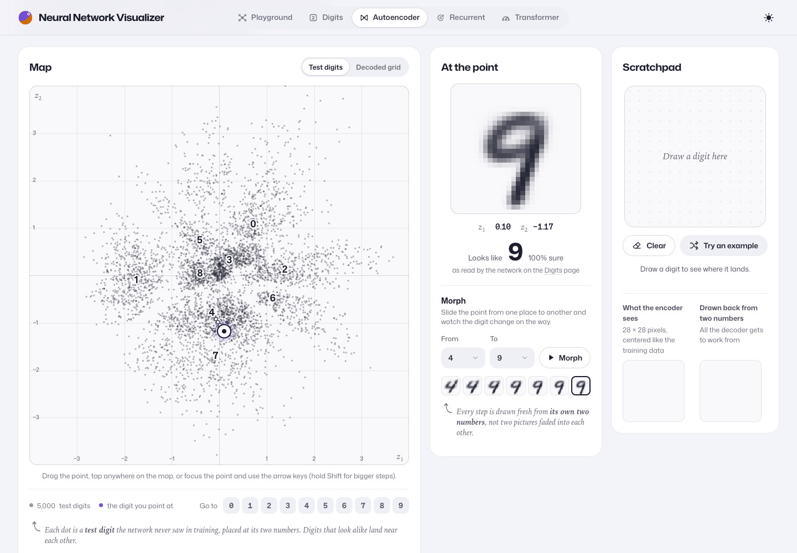
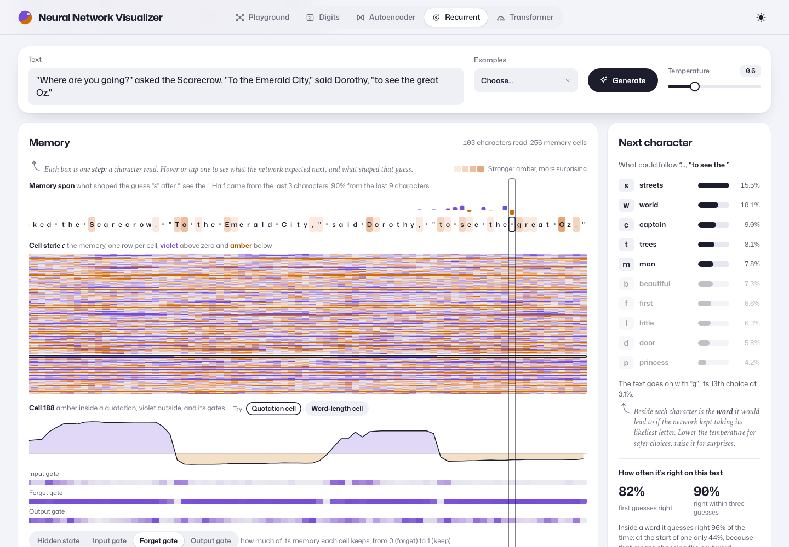
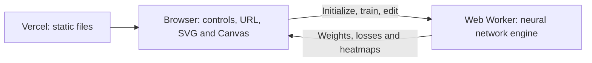

# Neural Network Visualizer

Five interactive neural networks you can look inside, in the browser:

- **Playground**: build and train a small network, with the learning features of [TensorFlow Playground](https://github.com/tensorflow/playground).
- **Digits**: draw a digit and watch a convolutional network trained on MNIST read it, filter by filter.
- **Autoencoder**: explore a map on which every point is a handwritten digit, and drag across it to watch one digit turn into another.
- **Recurrent**: watch an LSTM read your text one character at a time, carrying its memory forward, and see how far back it remembers.
- **Transformer**: run the real GPT-2 small and follow a prompt through tokens, embeddings, every attention head and MLP, to the next-word probabilities.

A violet/amber signal palette makes behavior visible: violet is positive, amber is negative, and the rest of the interface stays neutral so color always means something. Everything runs in the browser: training and GPT-2 run in Web Workers, and GPT-2 uses the visitor's own GPU through WebGPU where the browser allows it. Vercel serves a static Vite build. No backend, database, environment variables, server GPU, or API keys are required.

<picture>
  <source media="(prefers-color-scheme: dark)" srcset="docs/studio-preview-dark.png">
  
</picture>

## Run locally

Use Node.js 24 LTS (the project accepts Node >=22.12).

```sh
npm ci
npm run dev
```

Open the local URL printed by Vite, usually `http://127.0.0.1:5173`.

To preview the production build:

```sh
npm run build
npm run preview
```

## Deploy to Vercel

1. Use the [Neural Network Visualizer repository](https://github.com/nisarganag/NNVisualizer), or a fork of it.
2. In Vercel, choose **Add New → Project** and import that repository.
3. If the repository contains several projects, select the folder containing this README and `package.json` as the **Root Directory**.
4. Use these settings (also provided in `vercel.json`):

| Setting | Value |
|---|---|
| Framework preset | Vite |
| Node.js version | 24.x |
| Install command | `npm ci` |
| Build command | `npm run build` |
| Output directory | `dist` |
| Environment variables | None |

5. Select **Deploy**. Add a custom domain under the project's Domains settings if desired.

Upload/commit source files and the lockfile. Vercel builds `dist` itself; `node_modules`, `dist`, and local reports are ignored. The URL uses a hash for experiment settings, so shared configurations require no special server routing. Fonts, icons, the workers, model weights and all application code are served from your own deployment.

The GPT-2 weights in `public/models/gpt2-v2/` total about 130 MB, split into files under 19 MB. Visitors download them only when they load the model on the Transformer page; `vercel.json` marks `/models/` as immutable, and the page keeps the files in Cache Storage, so repeat visits don't download them again. Each first load still counts against your Vercel bandwidth allowance.

## Features

### Playground

- Classification datasets: circle, XOR, two Gaussians, spiral, or **draw your own**: choose the tile, then click the decision boundary plot to place violet or amber points (or erase them). The network keeps learning as points are added, and the points travel in the share link (up to 400).
- Regression datasets: plane, multiple Gaussian regions, or **draw your own**: pick a value from -1 (amber) to 1 (violet) with the slider, then click the prediction surface to place points with it (or erase them). These points travel in the share link too.
- **Upload CSV**, for either problem: your own points as a file with the columns x1, x2 and a label (classification: 1 for violet, -1 for amber, and 0 also means amber) or a value (regression), with or without a header row, separated by commas, semicolons or tabs. **Sample CSV** downloads an example in the current problem's format: two clouds for classification, a smooth hill for regression. The file becomes that problem's hand-drawn dataset on a fresh network, so it can be edited, cleared and shared like one. Coordinates beyond the plot's -6 to 6 are rescaled onto it, as are regression values beyond -1 to 1; a file with more than 400 points keeps an evenly spread 400, and a file that can't be read says which line to fix.
- Seven selectable features: x₁, x₂, x₁², x₂², x₁x₂, sin(x₁), sin(x₂).
- Zero to six hidden layers, with one to eight neurons per layer; bias-only models with all features disabled also work.
- Play, pause, single-epoch stepping, reset, regeneration, noise, training/test split, and batch size.
- Tanh, ReLU, Leaky ReLU, GELU, sigmoid, and linear activation; no regularization, L1, or L2.
- Optimizers: SGD (the original playground's update, unchanged), Momentum, and Adam.
- **Show backpropagation**: each connection gets a twin that shows how the last update pushed that weight (violet up, amber down, thicker for larger gradients). While training, the dashes flow backward from the output; a single step replays the forward pass and then the error travelling back.
- Live neuron and output heatmaps, signed/weighted connections, editable weights and biases, train/test losses and history.
- Test-data visibility, discrete output, neuron hover inspection, and shareable URL settings.
- Classroom control visibility, `initZero=true`, `hideText=true`, and optional bundled lessons.
- Keyboard-accessible feature and dataset controls, and horizontal network scrolling on small screens.
- A purpose-built studio interface with locally hosted Mona Sans, math-typeset input labels, circular neuron previews, model parameter counts, training status, and responsive data/results panels.
- Light and dark themes. The studio follows the system setting until you choose one with the toggle; the choice is remembered on that device. Each theme has its own signal colors, checked for contrast and color-vision-deficiency separation, and every heatmap, connection and thumbnail repaints without resetting the experiment.
- Motion that follows cause and effect: the network wires itself up on load, neurons glide into place when you change the architecture, signals flow along the connections while training, hovering a neuron highlights its connections, and the theme change sweeps out from the toggle. Reduced-motion settings turn all of it off.
- Copy-link sharing, a learning guide, and classroom navigation that preserve the current experiment and epoch.
- Margin notes on the graph point out what to try: hovering neurons, editing weights, switching inputs on.

The default experiment is small and quick to learn: the circle dataset, inputs x₁ and x₂, two hidden layers of 4 and 2 neurons, Tanh, no regularization, learning rate `0.03`, batch size `10`, 50% training data, no noise, seed `0.68936`. The larger configuration from the original reference link (Gaussian data, `8,8,8,8,8`, all seven features, L1 at `0.01`, learning rate `0.001`, batch size `13`) still opens from its URL and is used by the numerical parity tests.

Hover over a connection or a neuron's small bias square and click to edit it. Edits apply immediately. Enter finishes editing and Escape closes the field. To share an experiment, use **Share experiment** or copy the page address. A shared URL restores the starting configuration and seed, not the current trained weights or epoch. If clipboard access is unavailable, a dialog provides a selectable link. Classroom visibility choices take effect when the shared link is opened or **Apply view** is selected.

### Digits

<picture>
  <source media="(prefers-color-scheme: dark)" srcset="docs/digits-preview-dark.png">
  
</picture>

- A scratchpad for mouse, touch and pen, classified live while you draw, plus **Try an example** (MNIST test digits) and **Clear**.
- The drawing is preprocessed exactly like MNIST: the ink is scaled into a 20×20 box and centered by mass in 28×28. The page shows that 28×28 input.
- Every layer is drawn: 8 and 16 feature maps from two 3×3 convolutions, both max-pooling layers, the 64-neuron dense layer, and probabilities for 0–9. Hovering or focusing a feature map shows the filter weights behind it.
- **What mattered most**: the ink that drove the answer, from the network's exact input gradient (gradient × input). Violet ink supports the answer; amber argues against it.
- **Fool the network**: pick a digit and the page flips a few pixels of what the network sees, one small step at a time, until it reads that digit, usually after about 18 pixel changes. Changed pixels are outlined, and Undo restores the original.
- About 52,000 parameters, trained in this repository on MNIST with rotation, scale, shift and stroke-width augmentation (`scripts/train-mnist-cnn.mjs`). Nothing you draw leaves the browser.

### Autoencoder

<picture>
  <source media="(prefers-color-scheme: dark)" srcset="docs/autoencoder-preview-dark.png">
  
</picture>

- A variational autoencoder trained on MNIST squeezes every digit into just two numbers, so every digit has a place on a 2D map, and its decoder can draw a digit from any point on it.
- **The map**: 5,000 test digits the network never trained on, as dots, with a numeral where each digit is most common. Or switch to the decoded grid, which draws the whole plane as digits that blend into each other.
- **The point**: drag it, tap the map, or move it with the arrow keys. The digit at that point is drawn live, along with what the Digits page's network reads it as.
- **Morph**: animate from one digit to another, or to your own drawing. Every step is drawn from its own two numbers, not two pictures faded into each other.
- **Scratchpad**: draw a digit, or try an example, to see where it lands on the map and how the decoder redraws it from two numbers.
- Trained in this repository with `scripts/train-mnist-vae.mjs`: an encoder of 784, 256 and 128 units down to two numbers, and a decoder back up to 784 pixels, 469,000 parameters in all. Digits that look alike overlap on the map (4, 9 and 5 most of all); a vote among each test digit's five nearest neighbors on the map names 81.6% of them correctly, and the Digits network reads 82% of the reconstructions correctly. The weights take 1.9 MB.

### Recurrent

<picture>
  <source media="(prefers-color-scheme: dark)" srcset="docs/recurrent-preview-dark.png">
  
</picture>

- A long short-term memory network (one layer of 256 cells, about 346,000 parameters) reads your text one character at a time and carries its memory forward. Type up to 400 characters or choose an example; the views update as you type.
- Each character is tinted by how surprising it was. Hover, focus or tap one (or move with the arrow keys) to see what the network expected next, at the temperature you set, and where the real next character ranked.
- **Next character**: its ten likeliest next characters, each with the word it would lead to if the network kept taking its likeliest letter. After "the Tin Woodman " it expects *said*, *and* or *was*; after "the Tin Wood" it is sure of *Woodman*. A score shows how often it was right on your text, and that the start of a word, where it has to choose the next word, is the hard part.
- **Memory**: a heatmap of all 256 cell states at every step (violet above zero, amber below), and a second map of the hidden state or the input, forget and output gates. Choose a row to trace that cell's memory and gates along the text.
- **Memory span**: for the chosen step, how much each earlier character shaped the guess (the exact gradient back through time, times the input), and how many of the latest characters hold half and 90% of it. On held-out text, half usually comes from the last 4 characters and 90% from the last 15.
- Cells that learned something recognizable are one click away: one tracks whether the text is inside a quotation (correlation −0.74 on held-out text), another counts the letters of the current word.
- **Why gates matter**: a gateless recurrent network with about as many weights (512 memory numbers instead of 256) reads the same text beside the LSTM, with its own surprise, memory span and accuracy. Up close the two lean on the last few characters alike; further back they part. 100 characters back, a character still pulls 10 times harder on the LSTM's guess, and 150 back 110 times, as a fade chart shows. The LSTM's cell 188 follows whether the text is inside a quotation (r = −0.74 on held-out text), while the gateless network's closest unit reaches only −0.29. Both can continue your text side by side. Trained the same way on the same books, the gateless network scores 1.85 bits per character against the LSTM's 1.77.
- **Generate** writes 120 more characters at about 30 a second, each picked from the five likeliest at the chosen temperature (0.6 by default), and can be stopped at any point. About 98% of the words it writes are real, but its sentences don't make sense: a network this small learns how English looks, not what it means.
- Trained in this repository with `scripts/train-char-lstm.mjs` on nineteen public-domain children's books from Project Gutenberg (5.1 million characters), from *Alice's Adventures in Wonderland* and *The Wonderful Wizard of Oz* to *The Jungle Book*, *Treasure Island* and the fairy tales of the Brothers Grimm and Hans Christian Andersen. Paragraphs with period slurs are left out of training. On the last 5% of each book, which it never trained on, it scores 1.77 bits per character and its first guess is right 63% of the time (82% within three guesses). Training takes about 1¾ hours on a 10-core M4; the weights take 1.4 MB.
- **English or हिन्दी**: a switch under the introduction loads a second pair of networks, the same LSTM and gateless designs trained the same way on nineteen public-domain Hindi books from [Hindi Wikisource](https://hi.wikisource.org/) (5.3 million characters), all first published before 1931: folk and children's tales such as *Tilismati Mundari*, *Rani Ketki ki Kahani* and *Prem Sagar*, Premchand's stories and novels, Jaishankar Prasad's stories, and four volumes of Devaki Nandan Khatri's *Chandrakanta Santati*. They read Devanagari one Unicode character at a time, so a vowel sign is a step of its own, shown on a dotted circle. On held-out text the Hindi LSTM scores 2.09 bits per character and its first guess is right 58.7% of the time (77.4% within three); the gateless network scores 2.18 bits and 57.1%. As in English, gates let memory reach further: 90% of a guess's pull comes from the last 29 characters, against 11 without gates. No Hindi cell follows quotations the way the English one does (the books mark dialogue less consistently; the best reaches r = 0.16), so the quotation views appear only in English; the word-length cell (r = 0.68) is there in both. The page's own labels stay in English, and `?lang=hi` opens it in Hindi. `scripts/fetch-hindi-books.mjs` downloads the books' proofread pages; both networks were trained on the Mac's GPU with `scripts/train-char-lstm-gpu.py` (Apple's MLX) in 29 and 19 minutes, then measured and exported by `scripts/train-char-lstm.mjs --import`, which checks that the page's own code scores them as the trainer did.

### Transformer

<picture>
  <source media="(prefers-color-scheme: dark)" srcset="docs/transformer-preview-dark.png">
  
</picture>

- GPT-2 small (124M parameters, OpenAI, MIT license) with its byte-level BPE tokenizer. Type any prompt or choose an example; the model loads with one click and is cached afterwards.
- Views for tokens and IDs, token and position embeddings, a 12-block overview, the 12 heads of any block, and for any head its queries, keys, values, weights, masked scaled scores, softmax attention and output. Also every token's 3,072 MLP activations, the final hidden state, and the next-token probabilities.
- Temperature, top-k and top-p update the probabilities instantly; **Generate** samples a token and appends it.
- **How the guess forms**: what GPT-2 would predict if it stopped after the embedding and after each of the 12 blocks (a "logit lens"), for any token you focus. Select a row to open that block.
- **Switch off heads**: switch off any attention head, or a whole block, and see how the prediction changes. Each candidate shows its probability with every head on and now, and a sentence sums up the biggest change. **Which heads matter** switches off each of the 144 heads alone and maps how much each one helps or holds back the top guess (about a second on the GPU; on the CPU it tests the open block's 12). On "When Mary and John went to the store, John gave a drink to", switching off block 1, head 1 drops " Mary" from 45% to 11%, while switching off block 12, head 11 raises it to 73%. That head, and block 11, head 8, are the "negative name movers" that interpretability research found in GPT-2 small for sentences like this (Wang et al., 2022).
- **Surprising words**: the prompt is tinted by how unexpected each token was to the model, in bits, so typos and odd word choices stand out.
- **Runs on your GPU**: where the browser supports WebGPU, the worker runs GPT-2 with its own WGSL kernels (8-bit matrix products, layer norm, attention, the vocabulary and the surprise statistics) and keeps keys and values on the GPU. Everything the page draws comes from that run, and it matches the CPU path to within rounding: logits within 1e-4, the same top tokens, the same greedy continuation. On an Apple M4, measured in the page, a 9-token prompt takes about 27 ms instead of 0.75 s, a 45-token prompt 75 ms instead of 3.7 s, the logit lens 11 ms instead of 0.36 s, and each generated token about 10 ms instead of 87 ms. Browsers without WebGPU, and any GPU that fails a start-up check against the CPU, use the TypeScript path. A line under the prompt says which processor runs and how long the last run took, with a switch to compare them; `?backend=cpu` starts on the CPU.
- The official weights are converted with `scripts/convert-gpt2.mjs` to 8-bit blocks of 64 with float16 scales. Eight embedding columns are kept exact, because GPT-2's final hidden state has a few outsized dimensions that would otherwise magnify rounding. Greedy decoding matches the float32 model token for token, and next-token probabilities stay within about 0.3 percentage points.
- Inspired by [Transformer Explainer](https://poloclub.github.io/transformer-explainer/) (Georgia Tech Polo Club); the design and code here are independent.

### Playground lessons and URLs

`#tutorial=intro` opens a bundled introductory lesson. Add trusted lesson HTML files to `src/tutorials/` and rebuild to add more. Unknown or invalid lesson names retain the normal article. Legacy URL fields such as `cosX`, `cosY`, and `collectStats` are retained for compatibility; they do not introduce additional features beyond the reference implementation.

## Architecture



| File | Responsibility |
|---|---|
| `src/nn.ts` | Original forward/backpropagation, gradients, and L1/L2 weight updates |
| `src/dataset.ts` | Original synthetic datasets and seeded shuffling |
| `src/features.ts` | Shared feature transforms and labels |
| `src/state.ts` | Defaults, bounded URL parsing, serialization, classroom visibility |
| `src/model-state.ts` | Model snapshots shared by the UI and worker |
| `src/simulation.ts` | Epoch execution, losses, parameter edits, and activation grids |
| `src/training.worker.ts` | Background execution and transferable grid buffers |
| `src/worker-protocol.ts` | Typed commands, responses, and generation identifiers |
| `src/playground.ts` | Controls, worker coordination, centered graph geometry, model statistics, and live inspection |
| `src/heatmap.ts`, `src/linechart.ts` | Responsive Canvas heatmaps and smoothed SVG loss curves |
| `src/palette.ts` | Theme-aware signal colors for points, activations and connections, read from CSS custom properties |
| `src/site.ts` | Shared by every page: theme toggle and the model switcher |
| `src/studio.ts` | Playground shortcuts, clipboard sharing/fallback, and native control presentation |
| `index.html`, `styles.css` | Playground page; shared theme tokens, typography, SVG icons, motion, and responsive design |
| `cnn/index.html`, `src/cnn/` | Digits page: drawing pad, preprocessing and inference (`model.ts`), layer views |
| `vae/index.html`, `src/vae/` | Autoencoder page: encoder and decoder (`model.ts`), the map, morphing and the scratchpad |
| `rnn/index.html`, `src/rnn/` | Recurrent page: text encoding, LSTM inference and backpropagation through time (`model.ts`), memory views |
| `transformer/index.html`, `src/transformer/` | Transformer page: tokenizer, GPT-2 inference in a worker on the CPU (`gpt2.ts`) or the GPU through WebGPU (`gpu.ts`), sampling, stage views |
| `scripts/` | Reproducible model conversion (GPT-2) and training (MNIST CNN, MNIST autoencoder, character LSTM); downloaded data stays outside the repository |
| `public/models/` | Versioned model files served with the site |

Only one automatic training request is in flight at a time. Each reset, data change, or parameter edit invalidates older snapshots. Manual epoch steps are queued explicitly. Each epoch preserves the reference's partial-batch accumulation and half-squared error, including its fixed Tanh classification output and linear regression output. Numerical divergence pauses training with a recovery message.

D3 v3 is retained for the existing visualization APIs; the interface and graph composition are redesigned. `vite.config.ts` binds its legacy UMD initializer to `globalThis` for ES-module compatibility in both development and production. It does not alter D3's algorithms or patch installed packages.

## Checks

```sh
npm test
npm run build
npx playwright install chromium
npm run test:e2e
```

Or run `npm run check` once Chromium is installed. The browser suite uses the production build. GitHub Actions runs the same checks on pushes and pull requests.

The browser suite has two Playwright projects. `chromium` runs every page in the headless shell, which has no WebGPU, so the Transformer page takes its CPU path there. `webgpu` runs `tests/browser/webgpu.spec.ts` in full Chromium on your machine's GPU and compares the result with the CPU path. CI runners have no GPU, so there it uses Chromium's software WebGPU (SwiftShader) and skips if the runner offers no adapter at all.

The numerical regression fixture was independently captured from the live reference on 2026-11-19. It compares losses and selected parameters at epochs 0, 1, and 10 to 12 decimal places. Additional tests cover updates, partial batches, parameter edits, invalid URLs, empty-input models, worker resets, all datasets and model settings, sharing, teaching controls, local assets, and narrow layouts.

See [validation notes](docs/validation.md) for the recorded checks and their scope.

## Attribution and license

The original playground was created by Daniel Smilkov and Shan Carter, Copyright 2016 Google Inc., under Apache-2.0. This adaptation keeps its license, source notices, and credits. It is an independent project and is not an official Google or TensorFlow product.

The reference is pinned at commit `02469bd3751764b20486015d4202b792af5362a6`; `docs/upstream.json` records original source hashes. See `LICENSE` and `public/THIRD_PARTY_NOTICES.txt` for licensing. The original analytics integration and TensorFlow footer logo are not included.
