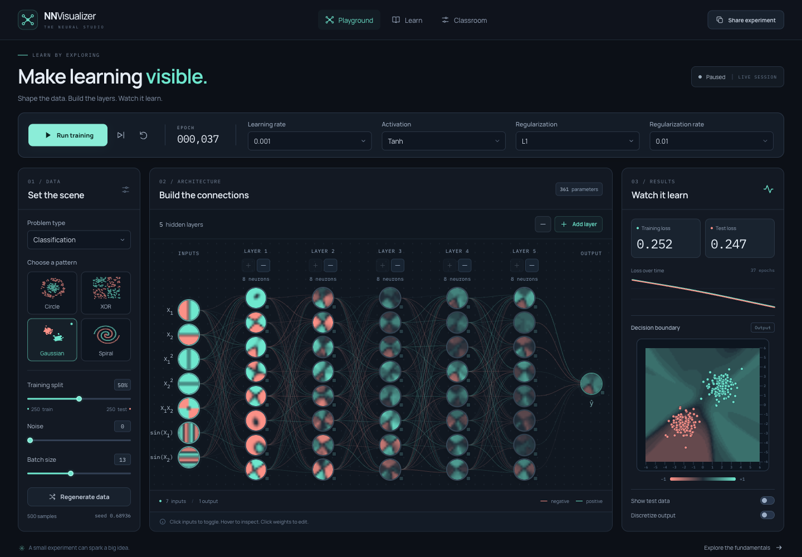
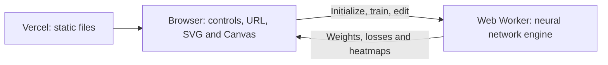

# NNVisualizer

A neural-network studio with an original dark interface and the interactive learning features of [TensorFlow Playground](https://github.com/tensorflow/playground). Circular activation previews, a live prediction map, and a shared mint/coral color system make the network's behavior visible. Training runs in a browser Web Worker; Vercel serves a static Vite build. No backend, database, environment variables, GPU service, or API keys are required.



## Run locally

Use Node.js 24 LTS (the project accepts Node >=22.12).

```sh
npm ci
npm run dev
```

Open the local URL printed by Vite, usually `http://127.0.0.1:5173`.

To preview the production build:

```sh
npm run build
npm run preview
```

## Deploy to Vercel

1. Use the [NNVisualizer repository](https://github.com/nisarganag/NNVisualizer), or a fork of it.
2. In Vercel, choose **Add New → Project** and import that repository.
3. If the repository contains several projects, select the folder containing this README and `package.json` as the **Root Directory**.
4. Use these settings (also provided in `vercel.json`):

| Setting | Value |
|---|---|
| Framework preset | Vite |
| Node.js version | 24.x |
| Install command | `npm ci` |
| Build command | `npm run build` |
| Output directory | `dist` |
| Environment variables | None |

5. Select **Deploy**. Add a custom domain under the project's Domains settings if desired.

Upload/commit source files and the lockfile. Vercel builds `dist` itself; `node_modules`, `dist`, and local reports are ignored. The URL uses a hash for experiment settings, so shared configurations require no special server routing. Fonts, icons, the training worker, and all application code are served from your own deployment.

## Features

- Classification datasets: circle, XOR, two Gaussians, spiral.
- Regression datasets: plane and multiple Gaussian regions.
- Seven selectable features: x₁, x₂, x₁², x₂², x₁x₂, sin(x₁), sin(x₂).
- Zero to six hidden layers, with one to eight neurons per layer; bias-only models with all features disabled also work.
- Play, pause, single-epoch stepping, reset, regeneration, noise, training/test split, and batch size.
- Tanh, ReLU, sigmoid, and linear activation; no regularization, L1, or L2.
- Live neuron and output heatmaps, signed/weighted connections, editable weights and biases, train/test losses and history.
- Test-data visibility, discrete output, neuron hover inspection, and shareable URL settings.
- Classroom control visibility, `initZero=true`, `hideText=true`, and optional bundled lessons.
- Keyboard-accessible feature and dataset controls, and horizontal network scrolling on small screens.
- A purpose-built studio interface with locally hosted Manrope/IBM Plex Mono, circular neuron previews, model parameter counts, training status, and responsive data/results panels.
- Copy-link sharing, a learning guide, and classroom navigation that preserve the current experiment and epoch.

The initial setup matches the supplied reference link: Gaussian classification; hidden layers `8,8,8,8,8`; all seven features; Tanh; L1 at `0.01`; learning rate `0.001`; batch size `13`; 50% training data; no noise; seed `0.68936`.

Hover over a connection or a neuron's small bias square and click to edit it. Edits apply immediately. Enter finishes editing and Escape closes the field. To share an experiment, use **Share experiment** or copy the page address. A shared URL restores the starting configuration and seed, not the current trained weights or epoch. If clipboard access is unavailable, a dialog provides a selectable link. Classroom visibility choices take effect when the shared link is opened or **Apply view** is selected.

`#tutorial=intro` opens a bundled introductory lesson. Add trusted lesson HTML files to `src/tutorials/` and rebuild to add more. Unknown or invalid lesson names retain the normal article. Legacy URL fields such as `cosX`, `cosY`, and `collectStats` are retained for compatibility; they do not introduce additional features beyond the reference implementation.

## Architecture



| File | Responsibility |
|---|---|
| `src/nn.ts` | Original forward/backpropagation, gradients, and L1/L2 weight updates |
| `src/dataset.ts` | Original synthetic datasets and seeded shuffling |
| `src/features.ts` | Shared feature transforms and labels |
| `src/state.ts` | Defaults, bounded URL parsing, serialization, classroom visibility |
| `src/model-state.ts` | Model snapshots shared by the UI and worker |
| `src/simulation.ts` | Epoch execution, losses, parameter edits, and activation grids |
| `src/training.worker.ts` | Background execution and transferable grid buffers |
| `src/worker-protocol.ts` | Typed commands, responses, and generation identifiers |
| `src/playground.ts` | Controls, worker coordination, centered graph geometry, model statistics, and live inspection |
| `src/heatmap.ts`, `src/linechart.ts` | Responsive Canvas heatmaps and SVG loss curves |
| `src/palette.ts` | Shared colors for points, activations, connections, and losses |
| `src/studio.ts` | Navigation, clipboard sharing/fallback, and native control presentation |
| `index.html`, `styles.css` | Original studio layout, typography, SVG icons, and responsive design |

Only one automatic training request is in flight at a time. Each reset, data change, or parameter edit invalidates older snapshots. Manual epoch steps are queued explicitly. Each epoch preserves the reference's partial-batch accumulation and half-squared error, including its fixed Tanh classification output and linear regression output. Numerical divergence pauses training with a recovery message.

D3 v3 is retained for the existing visualization APIs; the interface and graph composition are redesigned. `vite.config.ts` binds its legacy UMD initializer to `globalThis` for ES-module compatibility in both development and production. It does not alter D3's algorithms or patch installed packages.

## Checks

```sh
npm test
npm run build
npx playwright install chromium
npm run test:e2e
```

Or run `npm run check` once Chromium is installed. The browser suite uses the production build. GitHub Actions runs the same checks on pushes and pull requests.

The numerical regression fixture was independently captured from the live reference on 2026-11-19. It compares losses and selected parameters at epochs 0, 1, and 10 to 12 decimal places. Additional tests cover updates, partial batches, parameter edits, invalid URLs, empty-input models, worker resets, all datasets and model settings, sharing, teaching controls, local assets, and narrow layouts.

See [validation notes](docs/validation.md) for the recorded checks and their scope.

## Attribution and license

The original playground was created by Daniel Smilkov and Shan Carter, Copyright 2016 Google Inc., under Apache-2.0. This adaptation keeps its license, source notices, and credits. It is an independent project and is not an official Google or TensorFlow product.

The reference is pinned at commit `02469bd3751764b20486015d4202b792af5362a6`; `docs/upstream.json` records original source hashes. See `LICENSE` and `public/THIRD_PARTY_NOTICES.txt` for licensing. The original analytics integration and TensorFlow footer logo are not included.
