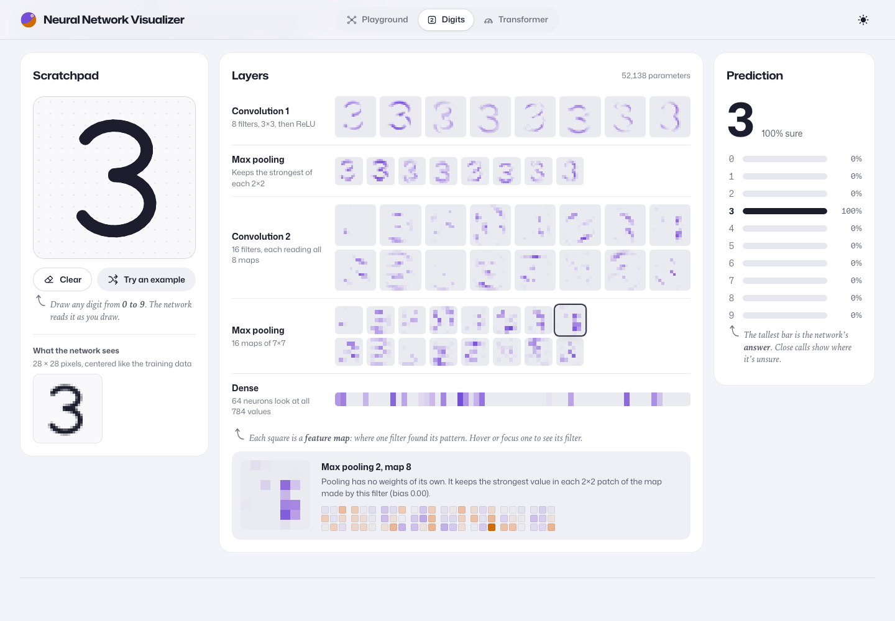
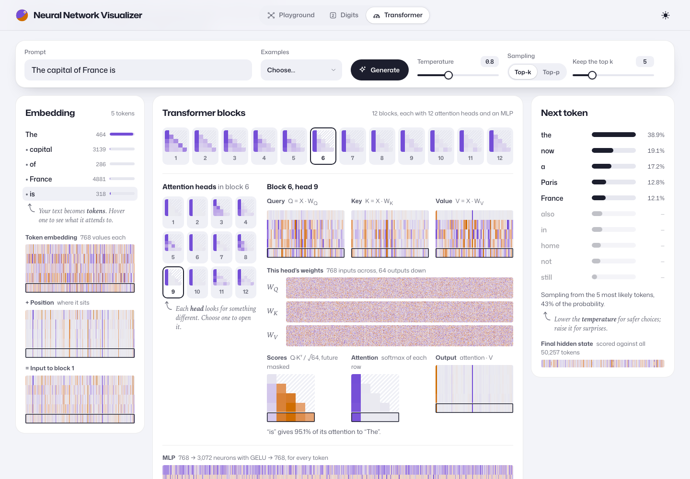
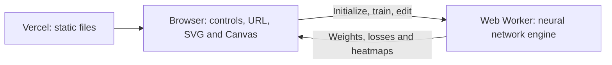

# Neural Network Visualizer

Three interactive neural networks you can look inside, in the browser:

- **Playground**: build and train a small network, with the learning features of [TensorFlow Playground](https://github.com/tensorflow/playground).
- **Digits**: draw a digit and watch a convolutional network trained on MNIST read it, filter by filter.
- **Transformer**: run the real GPT-2 small and follow a prompt through tokens, embeddings, every attention head and MLP, to the next-word probabilities.

A violet/amber signal palette makes behavior visible: violet is positive, amber is negative, and the rest of the interface stays neutral so color always means something. Everything runs in the browser, with training and GPT-2 in Web Workers; Vercel serves a static Vite build. No backend, database, environment variables, GPU service, or API keys are required.

<picture>
  <source media="(prefers-color-scheme: dark)" srcset="docs/studio-preview-dark.png">
  
</picture>

## Run locally

Use Node.js 24 LTS (the project accepts Node >=22.12).

```sh
npm ci
npm run dev
```

Open the local URL printed by Vite, usually `http://127.0.0.1:5173`.

To preview the production build:

```sh
npm run build
npm run preview
```

## Deploy to Vercel

1. Use the [Neural Network Visualizer repository](https://github.com/nisarganag/NNVisualizer), or a fork of it.
2. In Vercel, choose **Add New → Project** and import that repository.
3. If the repository contains several projects, select the folder containing this README and `package.json` as the **Root Directory**.
4. Use these settings (also provided in `vercel.json`):

| Setting | Value |
|---|---|
| Framework preset | Vite |
| Node.js version | 24.x |
| Install command | `npm ci` |
| Build command | `npm run build` |
| Output directory | `dist` |
| Environment variables | None |

5. Select **Deploy**. Add a custom domain under the project's Domains settings if desired.

Upload/commit source files and the lockfile. Vercel builds `dist` itself; `node_modules`, `dist`, and local reports are ignored. The URL uses a hash for experiment settings, so shared configurations require no special server routing. Fonts, icons, the workers, model weights and all application code are served from your own deployment.

The GPT-2 weights in `public/models/gpt2-v2/` total about 130 MB, split into files under 19 MB. Visitors download them only when they load the model on the Transformer page; `vercel.json` marks `/models/` as immutable, and the page keeps the files in Cache Storage, so repeat visits don't download them again. Each first load still counts against your Vercel bandwidth allowance.

## Features

### Playground

- Classification datasets: circle, XOR, two Gaussians, spiral.
- Regression datasets: plane and multiple Gaussian regions.
- Seven selectable features: x₁, x₂, x₁², x₂², x₁x₂, sin(x₁), sin(x₂).
- Zero to six hidden layers, with one to eight neurons per layer; bias-only models with all features disabled also work.
- Play, pause, single-epoch stepping, reset, regeneration, noise, training/test split, and batch size.
- Tanh, ReLU, sigmoid, and linear activation; no regularization, L1, or L2.
- Live neuron and output heatmaps, signed/weighted connections, editable weights and biases, train/test losses and history.
- Test-data visibility, discrete output, neuron hover inspection, and shareable URL settings.
- Classroom control visibility, `initZero=true`, `hideText=true`, and optional bundled lessons.
- Keyboard-accessible feature and dataset controls, and horizontal network scrolling on small screens.
- A purpose-built studio interface with locally hosted Mona Sans, math-typeset input labels, circular neuron previews, model parameter counts, training status, and responsive data/results panels.
- Light and dark themes. The studio follows the system setting until you choose one with the toggle; the choice is remembered on that device. Each theme has its own signal colors, checked for contrast and color-vision-deficiency separation, and every heatmap, connection and thumbnail repaints without resetting the experiment.
- Motion that follows cause and effect: the network wires itself up on load, neurons glide into place when you change the architecture, signals flow along the connections while training, hovering a neuron highlights its connections, and the theme change sweeps out from the toggle. Reduced-motion settings turn all of it off.
- Copy-link sharing, a learning guide, and classroom navigation that preserve the current experiment and epoch.
- Margin notes on the graph point out what to try: hovering neurons, editing weights, switching inputs on.

The default experiment is small and quick to learn: the circle dataset, inputs x₁ and x₂, two hidden layers of 4 and 2 neurons, Tanh, no regularization, learning rate `0.03`, batch size `10`, 50% training data, no noise, seed `0.68936`. The larger configuration from the original reference link (Gaussian data, `8,8,8,8,8`, all seven features, L1 at `0.01`, learning rate `0.001`, batch size `13`) still opens from its URL and is used by the numerical parity tests.

Hover over a connection or a neuron's small bias square and click to edit it. Edits apply immediately. Enter finishes editing and Escape closes the field. To share an experiment, use **Share experiment** or copy the page address. A shared URL restores the starting configuration and seed, not the current trained weights or epoch. If clipboard access is unavailable, a dialog provides a selectable link. Classroom visibility choices take effect when the shared link is opened or **Apply view** is selected.

### Digits

<picture>
  <source media="(prefers-color-scheme: dark)" srcset="docs/digits-preview-dark.png">
  
</picture>

- A scratchpad for mouse, touch and pen, classified live while you draw, plus **Try an example** (MNIST test digits) and **Clear**.
- The drawing is preprocessed exactly like MNIST: the ink is scaled into a 20×20 box and centered by mass in 28×28. The page shows that 28×28 input.
- Every layer is drawn: 8 and 16 feature maps from two 3×3 convolutions, both max-pooling layers, the 64-neuron dense layer, and probabilities for 0–9. Hovering or focusing a feature map shows the filter weights behind it.
- About 52,000 parameters, trained in this repository on MNIST with rotation, scale, shift and stroke-width augmentation (`scripts/train-mnist-cnn.mjs`). Nothing you draw leaves the browser.

### Transformer

<picture>
  <source media="(prefers-color-scheme: dark)" srcset="docs/transformer-preview-dark.png">
  
</picture>

- GPT-2 small (124M parameters, OpenAI, MIT license) with its byte-level BPE tokenizer. Type any prompt or choose an example; the model loads with one click and is cached afterwards.
- Views for tokens and IDs, token and position embeddings, a 12-block overview, the 12 heads of any block, and for any head its queries, keys, values, weights, masked scaled scores, softmax attention and output. Also every token's 3,072 MLP activations, the final hidden state, and the next-token probabilities.
- Temperature, top-k and top-p update the probabilities instantly; **Generate** samples a token and appends it.
- The official weights are converted with `scripts/convert-gpt2.mjs` to 8-bit blocks of 64 with float16 scales. Eight embedding columns are kept exact, because GPT-2's final hidden state has a few outsized dimensions that would otherwise magnify rounding. Greedy decoding matches the float32 model token for token, and next-token probabilities stay within about 0.3 percentage points.
- Inspired by [Transformer Explainer](https://poloclub.github.io/transformer-explainer/) (Georgia Tech Polo Club); the design and code here are independent.

### Playground lessons and URLs

`#tutorial=intro` opens a bundled introductory lesson. Add trusted lesson HTML files to `src/tutorials/` and rebuild to add more. Unknown or invalid lesson names retain the normal article. Legacy URL fields such as `cosX`, `cosY`, and `collectStats` are retained for compatibility; they do not introduce additional features beyond the reference implementation.

## Architecture



| File | Responsibility |
|---|---|
| `src/nn.ts` | Original forward/backpropagation, gradients, and L1/L2 weight updates |
| `src/dataset.ts` | Original synthetic datasets and seeded shuffling |
| `src/features.ts` | Shared feature transforms and labels |
| `src/state.ts` | Defaults, bounded URL parsing, serialization, classroom visibility |
| `src/model-state.ts` | Model snapshots shared by the UI and worker |
| `src/simulation.ts` | Epoch execution, losses, parameter edits, and activation grids |
| `src/training.worker.ts` | Background execution and transferable grid buffers |
| `src/worker-protocol.ts` | Typed commands, responses, and generation identifiers |
| `src/playground.ts` | Controls, worker coordination, centered graph geometry, model statistics, and live inspection |
| `src/heatmap.ts`, `src/linechart.ts` | Responsive Canvas heatmaps and smoothed SVG loss curves |
| `src/palette.ts` | Theme-aware signal colors for points, activations and connections, read from CSS custom properties |
| `src/site.ts` | Shared by every page: theme toggle and the model switcher |
| `src/studio.ts` | Playground shortcuts, clipboard sharing/fallback, and native control presentation |
| `index.html`, `styles.css` | Playground page; shared theme tokens, typography, SVG icons, motion, and responsive design |
| `cnn/index.html`, `src/cnn/` | Digits page: drawing pad, preprocessing and inference (`model.ts`), layer views |
| `transformer/index.html`, `src/transformer/` | Transformer page: tokenizer, GPT-2 inference (`gpt2.ts`) in a worker, sampling, stage views |
| `scripts/` | Reproducible model conversion (GPT-2) and training (MNIST CNN); downloaded data stays outside the repository |
| `public/models/` | Versioned model files served with the site |

Only one automatic training request is in flight at a time. Each reset, data change, or parameter edit invalidates older snapshots. Manual epoch steps are queued explicitly. Each epoch preserves the reference's partial-batch accumulation and half-squared error, including its fixed Tanh classification output and linear regression output. Numerical divergence pauses training with a recovery message.

D3 v3 is retained for the existing visualization APIs; the interface and graph composition are redesigned. `vite.config.ts` binds its legacy UMD initializer to `globalThis` for ES-module compatibility in both development and production. It does not alter D3's algorithms or patch installed packages.

## Checks

```sh
npm test
npm run build
npx playwright install chromium
npm run test:e2e
```

Or run `npm run check` once Chromium is installed. The browser suite uses the production build. GitHub Actions runs the same checks on pushes and pull requests.

The numerical regression fixture was independently captured from the live reference on 2026-11-19. It compares losses and selected parameters at epochs 0, 1, and 10 to 12 decimal places. Additional tests cover updates, partial batches, parameter edits, invalid URLs, empty-input models, worker resets, all datasets and model settings, sharing, teaching controls, local assets, and narrow layouts.

See [validation notes](docs/validation.md) for the recorded checks and their scope.

## Attribution and license

The original playground was created by Daniel Smilkov and Shan Carter, Copyright 2016 Google Inc., under Apache-2.0. This adaptation keeps its license, source notices, and credits. It is an independent project and is not an official Google or TensorFlow product.

The reference is pinned at commit `02469bd3751764b20486015d4202b792af5362a6`; `docs/upstream.json` records original source hashes. See `LICENSE` and `public/THIRD_PARTY_NOTICES.txt` for licensing. The original analytics integration and TensorFlow footer logo are not included.
